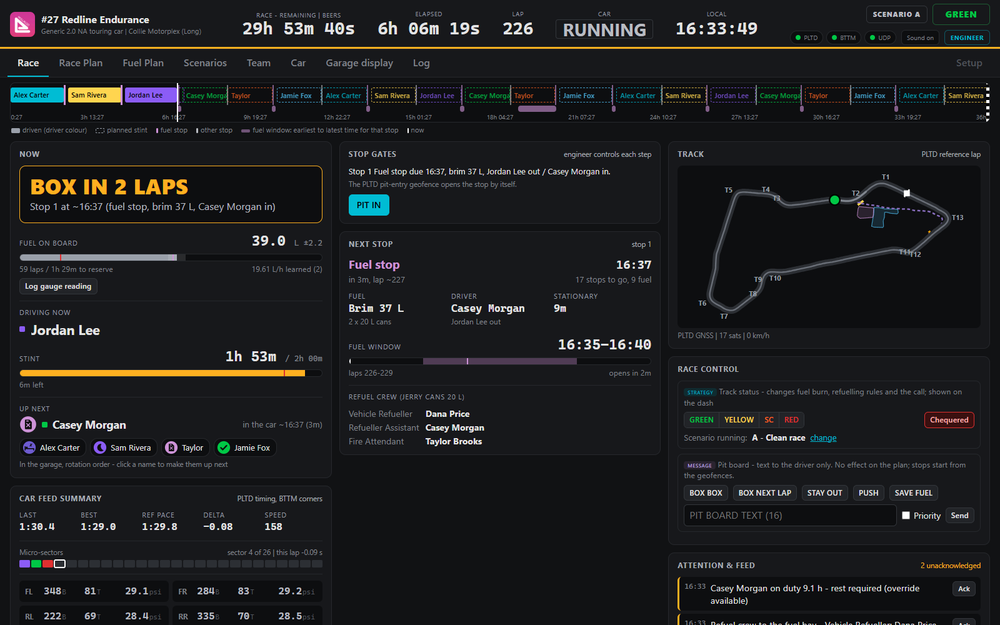
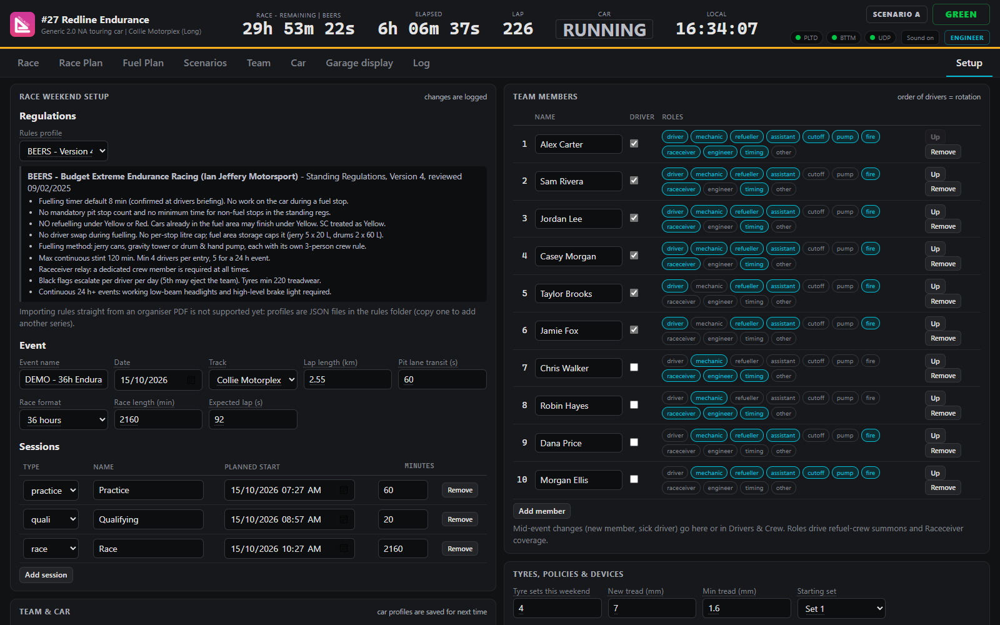
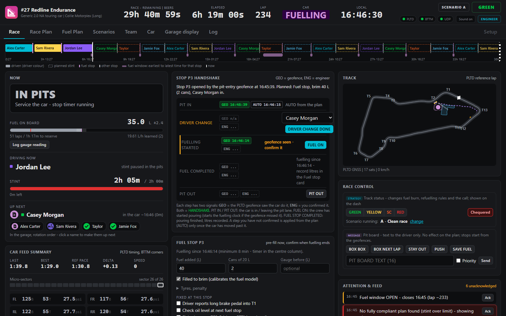
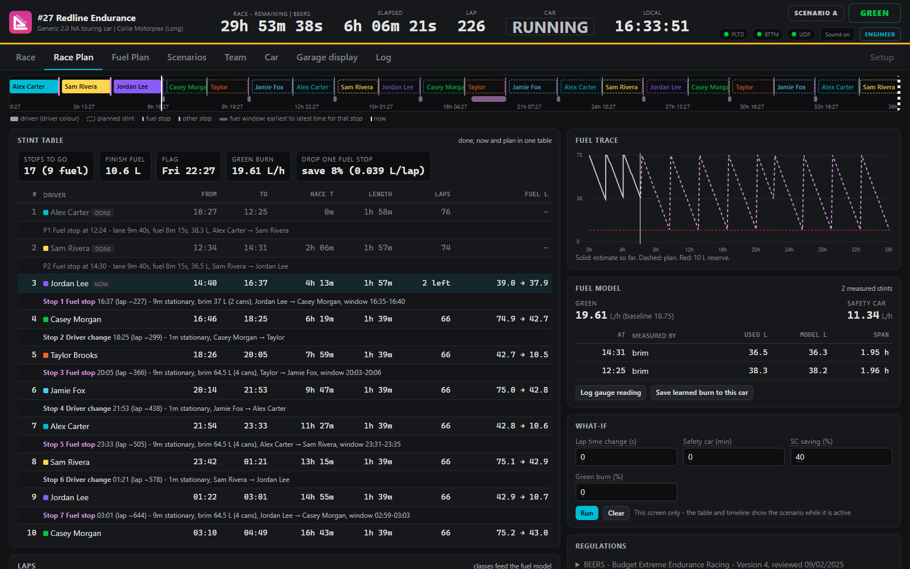
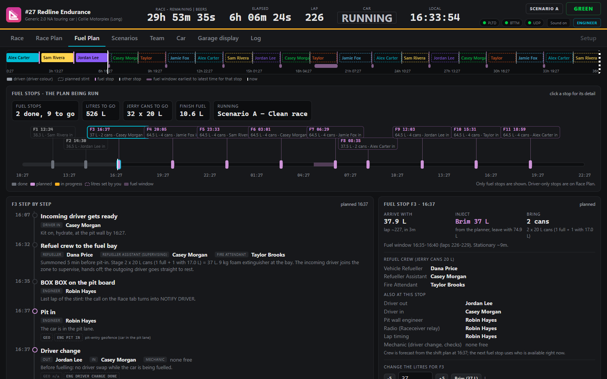
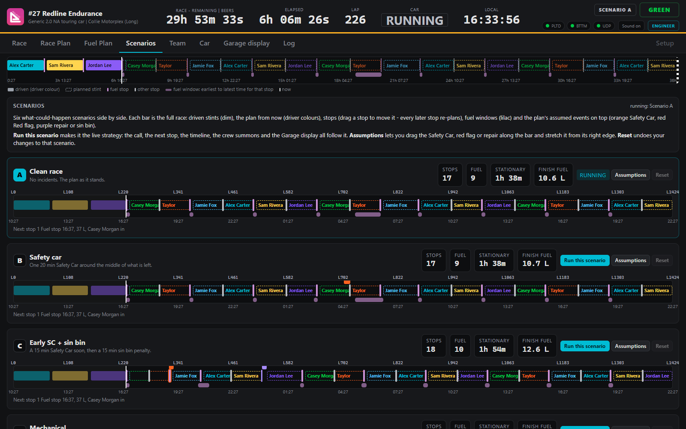
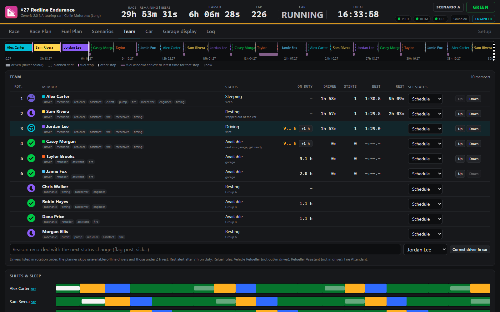
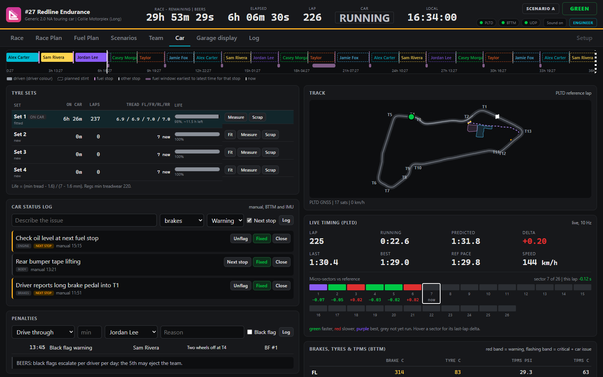
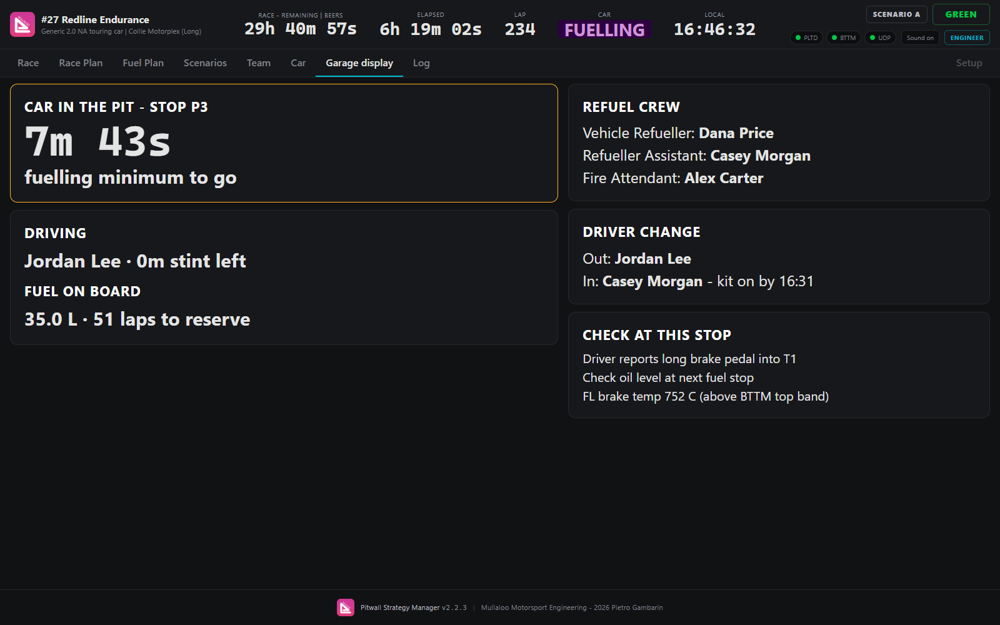
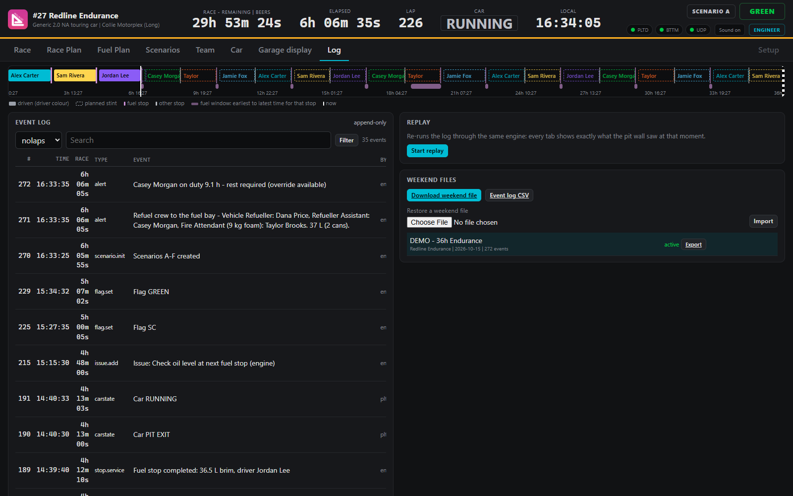

# Pitwall Strategy Manager

**An offline, self-hosted pit wall for endurance racing.** One laptop runs a small server; the engineer works in a browser on that laptop, and any phone, tablet or TV on the same Wi-Fi sees the same screens, view-only. No internet, no cloud account, no subscription.




> **Free and open source.** Pitwall Strategy Manager is released under the [GNU GPL v3](LICENSE). Use it, fork it, rebrand it and change it for your own team, series or car. See [License](#license).

---

## Contents

- [What it does](#what-it-does)
- [Quick start](#quick-start)
- [Try the demo](#try-the-demo)
- [A tour of the app](#a-tour-of-the-app)
- [Connecting devices](#connecting-devices)
- [Who can change what](#who-can-change-what)
- [Your data and backups](#your-data-and-backups)
- [Make it your own](#make-it-your-own)
- [Troubleshooting](#troubleshooting)
- [Gotchas for first-time users](#gotchas-for-first-time-users)
- [Documentation](#documentation)
- [Release notes](#release-notes)
- [License](#license)

## What it does

Pitwall Strategy Manager answers, every second, the questions a pit wall asks during a long race:

| Question | What the app gives you |
|---|---|
| **Should the car stop now?** | One call, recomputed every second: STAY OUT, WINDOW OPEN, BOX IN 3 LAPS ... NOTIFY DRIVER: BOX BOX. |
| **How much fuel is in the car?** | A fuel model that learns the real burn from every brim fill and gauge reading, split into green-flag and Safety Car rates. |
| **What is the plan to the flag?** | Stops, fuel loads and driver changes, kept legal against your series rules (stint limit, fuel stop minimum, mandatory stops, no refuelling under flags). |
| **What if there is a Safety Car?** | Six side-by-side scenarios. Drag a stop or a Safety Car and the rest of the race re-plans live. |
| **Who does what at the next stop?** | Litres, jerry cans, the refuel crew by name and a step-by-step procedure for every fuel stop. |
| **Who is fit to drive?** | Driver rotation, crew presence, rest and sleep, and alerts before anyone goes over their limits. |
| **What happened?** | An append-only race log you can export, import on another laptop and replay through the whole app. |

It works with nothing but a keyboard. Hook up a GPS lap timer and tyre/brake telemetry and laps, pit lane entries, flags and temperatures arrive by themselves.

## Quick start

**You need:** a Windows 10/11 laptop and [Node.js 18 or newer (LTS)](https://nodejs.org). The one dependency (`ws`) is already in the repo, so nothing else is downloaded.

1. **Get the code.** Download the ZIP from GitHub (green **Code** button, **Download ZIP**) and unzip it, or `git clone` the repository.
2. **Start the server.** Double-click `start-pitwall.bat`. Your browser opens `http://localhost:8080`, and the console prints the address other devices can use, for example `http://192.168.0.23:8080`.
3. **Allow the firewall prompt.** The first time, Windows asks whether Node.js may use the network: allow **Private networks**.
4. **Create your race weekend.** The first launch opens **Setup**. Fill it in and press **Create race weekend**. Restarting the server resumes the weekend automatically.

On macOS or Linux, run the same server from a terminal:

```bash
npm start
```

## Try the demo

The demo builds a 36-hour race that has been running for 6 hours, with laps, stops, a Safety Car, car issues and a full crew. A simulator then plays the car: it laps, obeys the pit board, and drives the pit lane when you call it in.

1. Double-click `make-demo.bat` (it only replaces the DEMO weekend; your real weekends are not touched).
2. Double-click `start-pitwall.bat`.
3. Double-click `start-simulator.bat` (a fake GPS lap timer plus a fake tyre/brake sensor unit).
4. When the call says **BOX**, press **BOX BOX** in Race control. The car pits at the end of the lap, and the Race tab switches to pit mode.

From a terminal the same steps are `npm run demo`, `npm start` and `npm run sim`.

> The demo is built relative to the moment you run it. If you come back a day later the clocks look odd: stop the server and run `make-demo.bat` again.

## A tour of the app

The screenshots below come from the demo, with an invented team (**#27 Redline Endurance**), six drivers, two engineers and two mechanics.

### 1. Set up the weekend



Pick the **rules profile** for your series, the track, the race length and the session times. Add every team member and tick the **roles** each one can do (driver, mechanic, refueller, fire attendant, radio, timing, engineer). The order of the drivers is the starting rotation. In **Team & car** set the tank sizes and the fuel baseline; the app refines the burn rate from real measurements as the race runs.

### 2. Run the race from one screen


The **Race** tab has three columns, each with one job:

- **Now:** the call, fuel on board with its uncertainty, the driver in the car with a stint bar against the limit, and who is up next.
- **Next:** the next stop (fuel, driver change, time stationary), its fuel window, and the refuel crew by name.
- **Track and feed:** the live map, Race control (flags and pit board messages), and the attention list: alerts stay there until someone presses **Ack**.

The status strip at the top (time remaining, lap, car state, flag, device lights) never moves, whatever tab you are on.

### 3. Call the car in and work the stop



Five minutes before a planned stop the call counts down (**BOX IN 3 LAPS**, 2, 1), then becomes **NOTIFY DRIVER: BOX BOX** with a one-click send. When the car enters the pit lane, the centre column becomes **pit mode**: every step of the stop (pit in, driver change, fuel on, fuel completed, pit out) is confirmed twice, once by the GPS geofence and once by you, and the timers show the time against the regulation minimums.

### 4. See the whole race plan



**Race Plan** is one stint table: done, now and planned, with every stop inline. Next to it are the fuel trace, the learned fuel model, a **what-if** box (slower laps, a Safety Car, a burn change) and the regulations in force.

### 5. Plan every fuel stop



**Fuel Plan** shows only the fuel stops. Click one to see litres on arrival, litres to add, the jerry cans to bring, the crew by role and a timed, step-by-step procedure from "refuel crew to the fuel bay" to pit out. Change the litres of a stop and a preview shows how every later stop moves before you apply it.

### 6. Prepare for what might happen



**Scenarios** keeps six versions of the rest of the race: clean, Safety Car, early SC plus a penalty, mechanical, chaos, driver down. Drag a stop or a Safety Car along a bar and everything after it re-plans while you drag. **Run this scenario** makes it the live strategy.

### 7. Look after the people



**Team** is one roster: rotation order, presence (available, driving, resting, sleeping, offline, flag duty, unavailable), hours on duty, time driven and best lap. Below it, the shift plan shows who drives, rests and sleeps across the whole race. The app raises a rest alert after too many hours on duty and summons the refuel crew by name five minutes before each fuel stop.

### 8. Watch the car



**Car** holds the tyre sets with life bars, the car issue log (flag an issue for the next stop and it shows up on the stop's job list), penalties, live timing with micro-sectors, and brake, tyre and pressure readings with alarm colours.

### 9. Put a screen in the garage



Open **Garage display** on a tablet or TV for the crew: the countdown to the next stop (or, with the car in, to the end of the fuelling minimum), the refuel crew, the driver change and the jobs for this stop, in type you can read from across the garage.

### 10. Review and replay



Every change is written to an append-only log. **Log** lets you search it, export the weekend (setup plus full log) or a CSV, import a weekend on another laptop, and **replay** the race: every tab shows what the pit wall saw at that moment.

## Connecting devices

Everything can be typed in by hand. If the car carries telemetry, the app reads it directly:

| Source | How it connects | What it gives |
|---|---|---|
| **PLTD** GPS lap timer | WebSocket to the device, plus HTTP for lap times and the track map | Laps, micro-sectors, live position, pit lane geofences (pit in, fuel bay, pit out); pit board messages and flags are sent back to the driver's dash |
| **BTTM** tyre/brake monitor | HTTP polled once a second | Brake and tyre temperatures and tyre pressures, with warning and critical alarms |
| **Anything else** | JSON over UDP, port 47800, one object per datagram | Laps, car state, flags, fuel readings, impacts, car issues |

UDP examples:

```json
{"t":"lap","n":12,"ms":91234,"pitted":false}
{"t":"flag","flag":"SC"}
{"t":"issue","cat":"engine","sev":"warn","text":"Oil temp high"}
```

Set the device addresses in **Setup**. The laptop must be on the same network as the devices.

## Who can change what

| Device | Can do |
|---|---|
| The laptop running the server (opened as `localhost`) | Everything. The badge reads **ENGINEER**. |
| Any other phone, tablet or laptop | Sees every tab, runs what-ifs locally, browses the log and replay. Cannot change anything: the badge reads **VIEW ONLY** and the server rejects changes. |

To give a second engineer laptop full control, add its IP address to `engineerHosts` in `data/settings.json` and restart. The port is set in the same file.

## Your data and backups

Everything lives in plain files in the `data` folder:

```
data/settings.json                  port, engineer laptops, last weekend (resumed at start)
data/cars/*.json                    car library, including learned fuel burn
data/events/<id>/events.jsonl       the race log: every change, append-only
data/events/<id>/config.json        the weekend as created
data/branding/logo.*                your logo, if you upload one
```

Copy the `data` folder to a USB stick or a second laptop at least once per session. If the laptop dies, copy the folder (or import the weekend file from **Log**) on another machine, start the server and carry on.

## Make it your own

The app is written to be adapted. Fork it and change whatever your team needs:

- **Branding:** the product, company and owner names live in `public/js/brand.js`; upload your logo in **Setup**, or replace `public/assets/`.
- **Series rules:** each regulation set is a JSON file in `rules/` (two are included). Copy one, edit the stint limit, fuel stop minimum, mandatory stops and flag rules, and restart.
- **Tracks:** track presets and the outline used by the map are in `lib/defaults.js` and `lib/tracks/`. With a PLTD, the device records its own reference lap and geofences at the track.
- **Car:** tank sizes, fuel baseline per track, refuel method and pour rate are set in **Setup** and saved to the car library for next time.
- **Tooltips:** hover any field for an explanation; the texts are in `public/js/tips.js`.
- **Code:** the strategy engine and the state reducer in `public/js/shared/` run identically on the server and in every browser. `npm test` runs pre-race plans and full simulated races against both included rule sets.

```bash
npm test
```

## Troubleshooting

| Symptom | Cause and fix |
|---|---|
| The console window closes straight away | Node.js is missing or older than 18. Install the current LTS from nodejs.org. |
| Phones and tablets cannot open the page | The firewall blocked Node.js (allow it on **Private networks**), the address is wrong (use the one printed in the console, not `localhost`), or the device is on a different Wi-Fi. |
| The laptop itself shows **VIEW ONLY** | You opened it through its network address. On the server laptop use `http://localhost:8080`. |
| "Reconnecting to pit wall server" banner | The server stopped or the Wi-Fi dropped. Restart `start-pitwall.bat`; the weekend resumes where it was. |
| Changes are not accepted | Replay is running (press **Back to live**) or the device is view-only. |
| Race tab columns are stacked | The window is narrower than about 1400 px. Maximise the browser or zoom out (Ctrl and minus). |
| PLTD or BTTM light is red | Wrong IP, the laptop is not on the car network, or the device is off. Check the IP on the device screen and in **Setup**. |
| PLTD light is amber ("stale") | Connected, but no data for 3 s: weak Wi-Fi or a busy device. |
| No track map or micro-sectors | The PLTD has not recorded its reference lap yet; it does so after the first clean lap. A live trail is drawn meanwhile. |
| A refuel role shows **UNASSIGNED** | Nobody tagged with that role is available. Press **FIX** for one-click options, or tag more people in **Setup**. |
| The fuel estimate drifts | No fuel measurement for a long time. Log a gauge reading, or tick **Filled to brim** at the next fuel stop. |
| A handshake step stays amber | The geofence saw it and you have not confirmed it. Press the step's button, or leave it: it becomes AUTO once the car moves on. |
| Simulator says "address in use" | Another simulator is still running. Close it, or start it with `--pltd` / `--bttm` on other ports and update **Setup**. |
| Demo clocks look wrong | The demo was built a while ago. Stop the server and run `make-demo.bat` again. |

## Gotchas for first-time users

- **Strategy versus message.** Flags, stop confirmations, driver changes and gauge readings change the plan. The pit board is only a message to the driver: sending **BOX BOX** does not create a stop. The stop starts when the car actually enters the pit lane (geofence) or you press **PIT IN**.
- **The engineer confirms; the geofence backs you up.** Each stop step needs your confirmation. If you miss one, the app applies the planned value automatically (marked **AUTO**) once the car has moved past it, and you can correct it afterwards.
- **Measure fuel early and often.** The model starts from the car's baseline burn for the track. Every brim fill or gauge reading makes it better. Press **Save learned burn to this car** after the race so the next event starts closer.
- **Tag roles honestly.** The app only assigns people to refuel duties if they are tagged with that role and available. It never fills a gap silently: an empty slot shows **UNASSIGNED** with the reason.
- **Durations always carry units.** `1h 55m` is a duration, `16:40` is a clock time. Switch to 12-hour clocks in **Setup** if you prefer.
- **Rules are data, not PDFs.** There is no importer for organiser PDFs. Copy a JSON profile in `rules/` and edit it to match your series' regulations; check the numbers before race day.
- **One server at a time.** Two copies of the app (or the old 1.x version) fight over port 8080 and the `data` folder. Close one first.
- **The race clock keeps running under a red flag** (a profile setting). Change `clock.stopsOnRed` in your rules file if your series stops it.
- **Replay has no map.** GPS positions are live only; they are not written to the log.
- **Back up the `data` folder.** It is the whole race. Copy it to a USB stick at every driver change if you can.

## Documentation

The full [user manual (PDF)](Pitwall_Strategy_Manager_User_Manual_v2.2.3.pdf) covers every screen, the pit stop workflow, the fuel model and the planner in detail, plus a guided demo and a feedback template.

## Release notes

- **2.2.4:** new README with a guided tour, troubleshooting and first-time gotchas. No change to the app.
- **2.2.3:** Car tab: live track map and a live timing card with micro-sectors; tyre sets moved to the top.
- **2.2.2:** larger base text and higher-contrast, taller shift bars.
- **2.2.1:** the track map moves to the top of the Race tab's right column; Race story becomes Race history.
- **2.2.0:** new **Fuel Plan** tab with per-stop procedure, cans and crew; the two-signal stop handshake (geofence + engineer).
- **2.1.x:** draggable scenarios that re-plan live, the lap countdown call before a stop, stop gates, the Collie Motorplex track preset.
- **2.0:** UI redesign following control-room (ISA-101) practice, with the same engine and data format as 1.x.

The full history is in the git log.

## License

Pitwall Strategy Manager is **free and open source software**, released under the [GNU General Public License v3.0](LICENSE).

You are welcome to take it and make it your own: run it at your events, fork it, rebrand it, add your series' rules, your tracks and your devices, and change anything else your team needs. There is no fee and no account.

The GPL asks one thing in return: if you **distribute** a modified version, share its source code under the same license so the next team can build on it too. Running a modified copy on your own pit wall needs nothing more.

Created by Pietro Gambarin, Mullaloo Motorsport Engineering. Contributions, bug reports and new rule profiles are welcome through GitHub issues and pull requests.
